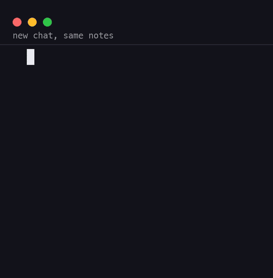

# BERNARD Brain Kit (free mini)



*First clip: what this free kit does (a brand-new chat finds the saved note). Clips two and three: the rule hooks that come with the full kit.*

## What it does
Claude Code forgets everything between sessions. This kit gives it a memory that finds itself: your notes live
in a plain folder of Markdown files (a vault), a map of them is built for you, and on every prompt a small hook
puts the notes that match in front of Claude before it answers. You see a short `BERNARD brain: on` line when a
session starts and a **BERNARD ROUTE** packet under each prompt.

This is the free mini. The full kit adds: capture of every file Claude changes into a devlog and an in-progress
session note, rule hooks (small Python files that block Claude when a rule is broken, four ready to use), the
`/bernard:save` and `/bernard:rule` skills, and the guide.

## What you need
* A Mac (macOS 13 or later). Mac only for now: Linux and Windows are not supported.
* Claude Code 2.x, signed in.
* Python 3.8 or newer (a Mac with the command-line tools has 3.9). Nothing else
  to install: the kit uses only Python's standard library.

## Install in three steps
1. **Get it** into a permanent folder (the plugin runs from there, so not `~/Downloads`):
   ```bash
   git clone https://github.com/albygira-cmyk/claude-brain-kit ~/bernard-brain-kit-free
   ```
2. Open a terminal, `cd` to that folder and run:
   ```bash
   bash install.sh
   ```
3. Open Claude Code and start a new session. Its first lines of context read `BERNARD brain: on`.

## What you will see
* **Boot line** - a short summary of the vault when the session starts.
* **BERNARD ROUTE packet** - on every prompt, up to five matching notes with their paths, or
  `NO_RELEVANT_MEMORY` when nothing matches (Claude is told never to invent a memory).

## Writing a note Claude can find
Put a Markdown file in `~/brain/topics/<domain>/<two-or-more-words>.md` (or `patterns/`, `references/`,
`projects/`, `sessions/`). Under the title, write one plain sentence saying what the note is for, in the words
you would search with. The map rebuilds itself on the next prompt; `python3 bin/brain.py map` rebuilds it now.

## Skills
* `/bernard:setup` - creates the vault and turns memory on (install.sh already did this).
* `/bernard:find` - searches the vault by hand and answers with note paths.

## Commands
```bash
python3 bin/brain.py status    # where the vault is, how many notes, is the map fresh
python3 bin/brain.py map       # rebuild MAP.md and the search index
python3 bin/brain.py check     # names and first sentences the router cannot use
python3 bin/brain.py doctor    # OK / FIX lines for every part of the install
```

## Uninstall
```bash
bash uninstall.sh
```
Removes the plugin and its internal folder `~/.bernard`. Your notes in `~/brain` stay unless you add
`--remove-vault --yes`.

## What is in the folder
```
.claude-plugin/          plugin manifest
hooks/                   boot.py, route.py, brainlib.py
bin/brain.py             command-line interface
vault-template/          starter notes and templates
skills/                  /bernard:setup, /bernard:find
README.md                (this file)
LICENSE.md               MIT
install.sh / uninstall.sh
```

## Tested and not tested
* Tested on macOS with Claude Code 2.1.x, Python 3.9 and 3.14.
* Not tested on Windows.
* Not tested on Linux.

## Privacy
The plugin itself makes no network calls, stores no keys, and reads only your vault (`~/brain` by default) and its
own folder `~/.bernard`. The notes it puts in front of Claude become part of your Claude Code conversation, so they go
to Anthropic like anything else you type there: keep passwords and keys out of your notes.

## Licence
MIT (see `LICENSE.md`). Your notes are yours.

## The full kit
The full kit (capture, four rule hooks, `/bernard:save` and `/bernard:rule`, the guide) is US$9, one time:
https://www.waar.com.hk/brain/
